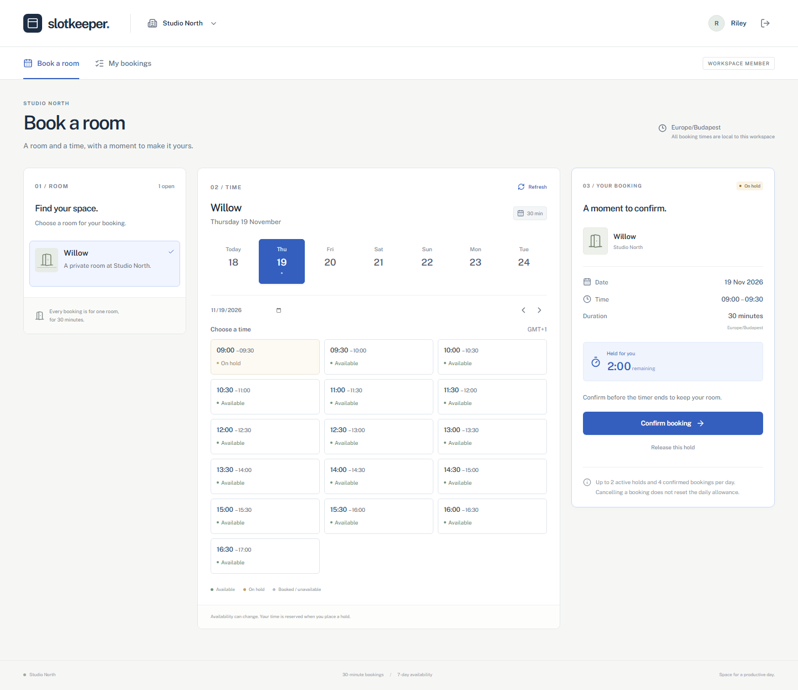
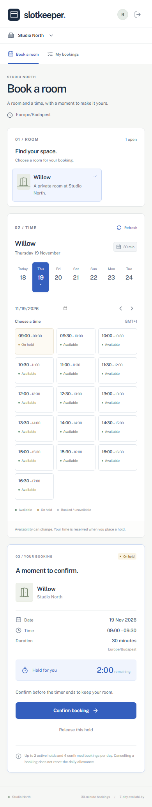
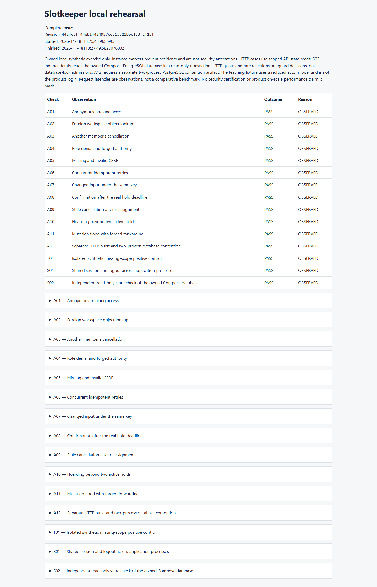

# Slotkeeper

A room-reservation product built to make ownership, retries and competing requests inspectable. Java owns the booking rules; PostgreSQL coordinates durable state across processes; React provides the normal member and administrator experience.

**Published reference release: [v0.1.0](https://github.com/gbalazsfalvi/slotkeeper/releases/tag/v0.1.0).** Tested executable code: `44a4caf`. See the [observed delivery record](docs/DELIVERY.md), [complete evidence snapshot](docs/evidence/v0.1.0/README.md), and [publication record](docs/PUBLICATION.md).

[](https://github.com/gbalazsfalvi/slotkeeper/actions/workflows/verify.yml)

Read the case study in [English](https://balazsfalvi.hu/work/slotkeeper/) or [Hungarian](https://balazsfalvi.hu/hu/munkak/slotkeeper/). Both include actual screenshots and a downloadable evidence bundle.



## What it demonstrates

| Area | Implementation and evidence |
| --- | --- |
| Booking product | Two workspaces, room availability, temporary holds, confirmation, cancellation, personal bookings and scoped room/activity administration |
| Authority | Server-side sessions, current database membership, per-workspace roles, object ownership, CSRF and strict typed request fields |
| Durable correctness | Atomic slot assignment, actor allowances, scoped idempotency receipts, successful booking events and expected-ID release |
| Abuse controls | Bounded bodies/password work, database-backed admission, quotas and explicit safe failures |
| Inspectable results | Twelve named abuse cases, an isolated vulnerable positive control, shared-session verification and independent database invariants/permissions |

Holds last at most 120 seconds on the server booking timeline, capped at slot start. Capacity is one; slots are 30 minutes; seven workspace-local dates are available. Each actor/workspace has at most two live holds and four successful confirmations per slot-local date. Cancellation retains history and does not refund the confirmation allowance. A workspace has at most 20 rooms, including disabled rooms.

The booking timeline cannot move backward. It can pause while a regressed wall clock catches up; [ADR 0005](docs/decisions/0005-durable-booking-time.md) explains that deliberate tradeoff and its physical-time limits.

## Run locally

Prerequisites: Git, a Java 21 JDK, Node.js 24.14 or later in the 24.x line, and a local Docker daemon with Docker Compose. Windows uses PowerShell 7.4 or newer; native Linux uses Bash, Python 3 and `flock`. Select Java 21 in the invoking shell. Dependencies, wrapper bytes and container images are pinned.

Use the current `main` checkout for a cold build. The immutable `v0.1.0` tag predates a [strict dependency-metadata correction](docs/DEPENDENCY_VERIFICATION.md); the original release and evidence are preserved. Current `main` also includes the documented [JDBC outage-handling follow-up](docs/PUBLICATION.md).

From the repository root, use PowerShell:

```powershell
pwsh -NoProfile -File ./slotkeeper.ps1 up
```

Or Bash:

```bash
./slotkeeper.sh up
```

Open [Slotkeeper](http://127.0.0.1:4190). The packaged application serves both the UI and API. Follow the [five-minute reviewer walkthrough](docs/WALKTHROUGH.md).

| Synthetic account | Workspace access |
| --- | --- |
| `alex` | Member, Harbor Works |
| `morgan` | Admin, Harbor Works |
| `riley` | Member, Studio North |
| `jordan` | Admin, Studio North; member, Harbor Works |

All four use the public fixture password **`Slotkeeper-Local-Only!`**. The sign-in screen can fill an account. These are local synthetic identities.

Use the same verb with either launcher:

| Verb | Purpose |
| --- | --- |
| `up` | Build and start the owned product and database |
| `status` | Inspect this local environment |
| `verify` | Run locked Java/PostgreSQL/frontend and launcher checks |
| `rehearse` | Obtain fresh verification evidence, start extra targets, export observed reports, then stop the extra targets |
| `down` | Stop the owned environment while retaining its database volume |

For example, `pwsh -NoProfile -File ./slotkeeper.ps1 rehearse` runs the complete local rehearsal. It requires a committed, clean source tree so the report identifies the tested revision. Runtime credentials and fresh reports stay in ignored local directories. Keep the private runtime configuration with the retained database between runs.

| Loopback port | Role |
| --- | --- |
| `4190` | Normal product UI/API |
| `4192` | Independent second app, explicit rehearsal only |
| `4193` | Isolated teaching fixture, explicit rehearsal only |
| `55419` | Owned PostgreSQL |
| `4195` | Optional Vite development server |

For separate browser verification after `up`, run `npx --no-install playwright install chromium` once in `web`, then `npx --no-install playwright test`. Browser journeys create real synthetic room/booking history and consume the documented allowances.

## Observed v0.1.0 results

| Check | Result |
| --- | --- |
| Java domain, application, PostgreSQL, verifier and fixture tests | 117 passed; zero failures/errors/skips |
| React behavior tests | 18 passed |
| Packaged browser journeys | 8 passed across desktop and mobile; zero retries |
| Mocked launcher safety cases | 14 passed; no real Docker commands in these cases |
| Actual security rehearsal | 15 PASS; zero FAIL, ERROR or INCOMPLETE |
| Two independent JVMs, 100 database attempts | 1 created reservation, 99 slot conflicts, 1 active assignment |
| Core coverage | 302/319 lines and 131/140 branches |

The [portable report](docs/evidence/v0.1.0/report.md), [JSON observations](docs/evidence/v0.1.0/report.json), [standalone HTML](docs/evidence/v0.1.0/report.html) and [independent contention artifact](docs/evidence/v0.1.0/database-contention.json) are actual exported evidence. Fresh rehearsal writes the same formats and `SHA256SUMS` under `artifacts/rehearsal/<timestamp>/`.

A11 sends 130 requests with at most eight in flight; this run observed 73 rate rejections and no transport errors. A12 separately releases 100 HTTP attempts together. It records quota/rate rejections as guard decisions; they do not establish database-lock admission. The independent database exercise uses 100 distinct synthetic actors across two JVMs on the production booking path below HTTP admission. Request latencies and elapsed test time are observations, not a production capacity benchmark.

<details>
<summary>Actual mobile booking screen</summary>



</details>

<details>
<summary>Actual complete rehearsal report</summary>



</details>

## Technical map and limits

Java 21, Gradle 9.2.0, Spring Boot 4.1.2, PostgreSQL 18.7 and React 19.3.1 form a modular monolith. The framework-free domain lives in `core`; HTTP/security/JDBC adapters and the packaged frontend live in `application`; `verification` and `training-target` are independent artifacts. The vulnerable fixture is absent from the normal product artifact and default runtime.

Read the [architecture](docs/ARCHITECTURE.md), [HTTP contract](docs/API.md), [threat model](docs/THREAT_MODEL.md), [decision notes](docs/decisions/README.md), [delivery goal](GOAL.md) and [implementation plan](docs/superpowers/plans/2026-11-18-slotkeeper-v1.md).

This release uses local HTTP, public fixture credentials and trusted local administration. Real-user onboarding, TLS deployment, external identity, payments, notifications, HA and PQC integration are future scopes. Separate Docker bridges are not an outbound-traffic sandbox. Instance markers prevent targeting accidents; report hashes detect changed bytes. Neither is a security certification. Windows launch and rehearsal are observed. The linked Actions workflow reports hosted verification separately; it does not run the native Linux launcher or the complete browser/rehearsal flow.

## Proposed next milestone

The selected direction is [issuer-backed PQC-signed hold admission](docs/superpowers/specs/2026-11-18-slotkeeper-pqc-admission-design.md). A separate issuer would approve a scoped hold intent, and booking replicas would verify and atomically redeem it once. The proposal combines admission budgets, bounded signing/verification work, cross-workspace measurements, and a same-topology Ed25519/ML-DSA comparison.

The [research note](docs/research/2026-11-18-pqc-admission-options.md) links the primary standards, alternatives, and an observed Java-provider smoke test. The detailed limits and contract await owner approval. V0.1.0 does not implement this extension, and PQC signing alone does not stop booking spam.

Licensed under [Apache-2.0](LICENSE); see [NOTICE](NOTICE) and the packaged [frontend notices](web/public/licenses/third-party.txt).
