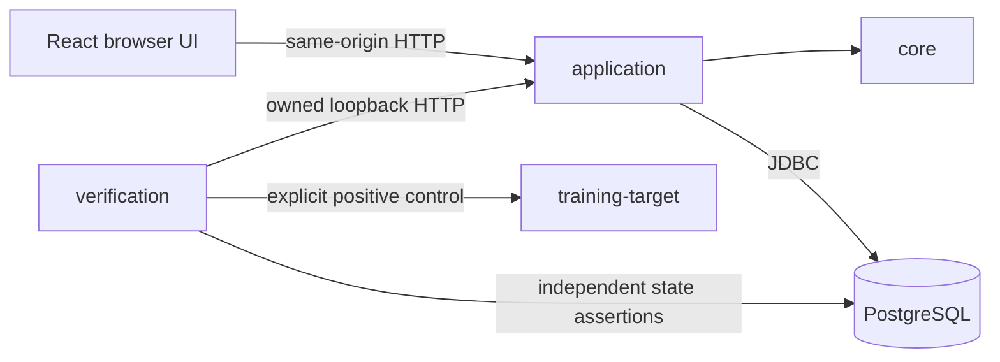
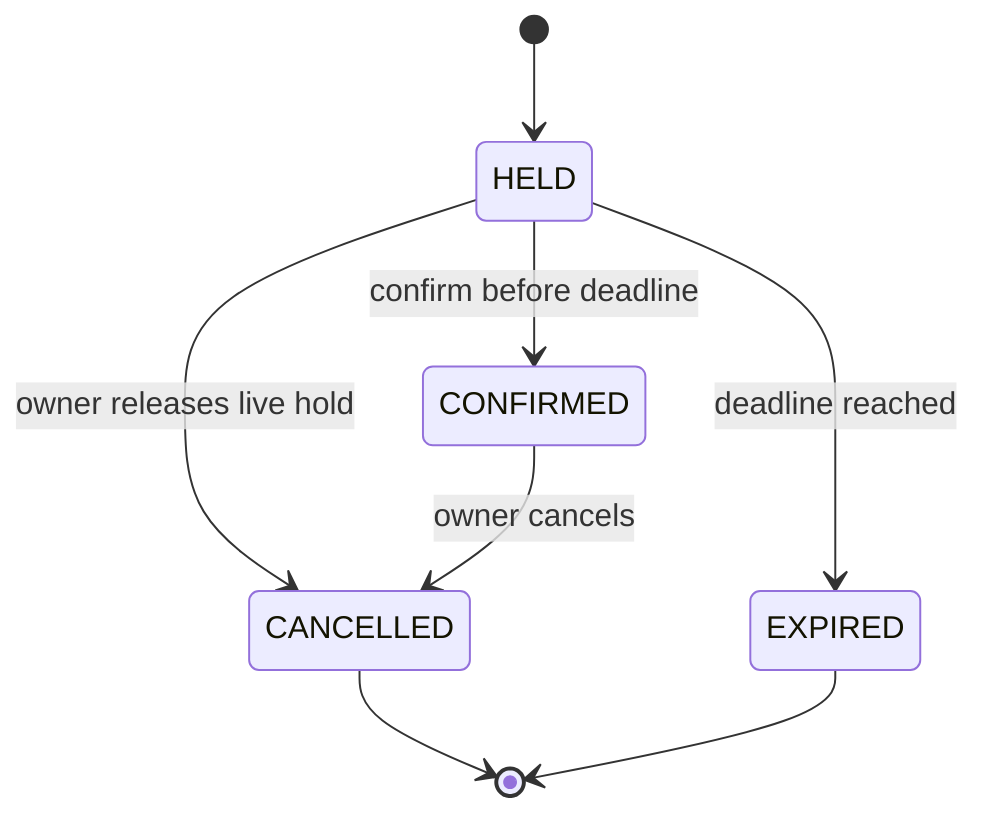

# Architecture

Slotkeeper is a local, synthetic room-reservation reference built as a modular monolith. PostgreSQL owns shared state and concurrency. The browser displays decisions; the application authenticates and authorizes them. The independent verification runner records observations rather than supplying product authority.

**Verification status:** pending final integrated verification. This document describes the code and frozen v1 contract; [DELIVERY.md](DELIVERY.md) records which checks actually ran.

## Components and dependencies

Arrows from the runner describe runtime observations, not Gradle dependencies. The product's only project dependency is `application → core`. Neither verification nor teaching code is an application runtime dependency.

| Area | Responsibility |
| --- | --- |
| `core` | Immutable identity/workspace/reservation values, policy, transitions, use cases and transaction/query ports; no Spring, JDBC, HTTP or JSON dependencies |
| `application` | Spring composition, authenticated HTTP, input/admission controls, JDBC adapters, migrations, maintenance and packaged static UI |
| `web` | React/TypeScript session flow, availability, booking and admin screens; built into the app's static resources |
| `verification` | Owned-target admission, independent HTTP/database assertions and sanitized report export |
| `training-target` | Separate intentionally missing-scope fixture with fixed synthetic records and a reduced actor model |

The selected stack is Java 21, Gradle 9.2.0, Spring Boot 4.1.2, PostgreSQL 18.7, React 19.3.1, TypeScript 5.9.3 and Vite 8.3.8. Catalogs and lockfiles hold dependency details. No message broker or cache participates in booking correctness.

## Local process boundary

Normal operation uses the packaged app on `127.0.0.1:4190` and the owned database on `127.0.0.1:55419`. Explicit rehearsal adds an independent app on `4192` sharing the same product database, and the teaching fixture on `4193`. The optional Vite server uses `4195` during frontend development.

The teaching process has no product session store or database access. It is not a vulnerable mode of the application. The scripts must enforce owned local Docker resources and explicit rehearsal activation; final Compose/script verification remains part of the release gate.

Migration and runtime credentials are separate. The normal runtime has Flyway disabled and receives the `slotkeeper_app` role. A one-shot migration process owns schema changes and synthetic seed initialization. The runtime may select/insert booking events, but cannot update or delete them. This privilege boundary does not protect against a database or host administrator.

## Identity and request boundary

Spring Security authenticates local accounts with Argon2id and an opaque `SLOTKEEPER_SESSION` cookie. Spring Session JDBC lets both app processes use the same session state. Login changes the session ID; logout invalidates the shared server session. The local cookie is HttpOnly, SameSite=Lax, Path=/, with a 30-minute idle timeout and `Secure=false` for local HTTP.

An authenticated principal supplies only the actor identity. The adapter checks account availability, and scoped operations read current workspace membership from PostgreSQL. A path parameter selects the requested workspace; it does not confer authority. Object queries include workspace and owner predicates. Admin room/activity access checks the role in that workspace. PostgreSQL composite foreign keys reinforce relationship scope; the database does not implement per-workspace row-level security.

CSRF protection covers login, logout and state-changing requests. Clients obtain `/api/csrf` and refresh the token after login. Typed DTOs reject unknown properties, duplicate JSON keys and trailing documents. Request bytes and login fields are bounded before parsing/password work. Exact paths, views, errors and limits are in [API.md](API.md).

## Reservation transaction

The core use case executes through `BookingUnitOfWork`. The JDBC adapter supplies one transaction for the business effect, slot assignment, retry receipt and event. The mutation path uses this order:

1. Resolve the authenticated actor and current scoped authority; validate typed input. Shared traffic admission completes before booking locks.
2. For hold/confirmation, insert or lock the scoped idempotency row and validate its fingerprint. An authorized replay returns the existing identity's current state.
3. Lock the actor/workspace guard, then the target room/slot rows, then the relevant reservation rows.
4. Obtain durable nondecreasing booking time from `DatabaseTime` after those locks. Check schedule, expiry, ownership, room state and allowances against this time.
5. Reconcile an expired old assignment if necessary; persist the new state, assignment, receipt and successful event atomically.

The actor guard serializes allowance decisions across rooms for the same actor/workspace. Slot locks serialize competing actors. A unique workspace/room/start identifies a slot; its single assignment references a reservation in that same workspace and slot. Releasing a slot checks the expected reservation ID, so an old cancellation cannot clear a replacement assignment.

The adapter sets a five-second lock timeout, ten-second statement timeout and fifteen-second transaction timeout. Contention/dependency failures return bounded safe errors; they do not commit a partial booking. These budgets are local reference settings, not throughput guarantees.

## Time and state

Slots are half-open UTC intervals `[startAt, endAt)` of 30 minutes. Selectable dates are today through today+6 in the workspace's named zone, with starts from 09:00 through 16:30. Past starts are unavailable. A hold expires at the earlier of creation+120 seconds and slot start; confirmation at the exact deadline is rejected.

Reads project an elapsed HELD reservation as EXPIRED even before cleanup persists the transition. The bounded expiry worker locks the room before its slot and reservation, obtains fresh booking time and releases only the expected assignment. It skips busy rooms/slots and does not acquire actor guards after slot locks. Correctness does not depend on a browser countdown or the cleanup schedule.

`DatabaseTime` atomically advances a singleton PostgreSQL row to `greatest(last_observed, clock_timestamp())` through a bounded independent autocommit connection. Observations survive a business rollback and do not hold the shared clock lock while waiting on booking locks. This prevents a backward wall-clock observation alone from reviving an elapsed hold or placing an action before reservation creation. Booking time can pause while a regressed wall clock catches up; the 120-second limit is measured on this logical timeline, not guaranteed physical elapsed time. Framework session expiry and rate windows remain separate wall-clock mechanisms. See [ADR 0005](decisions/0005-durable-booking-time.md) for the observed fault, guarantees and limits.

Each actor/workspace has at most two unexpired holds. Four successful confirmations are allowed per slot-local date. `confirmedAt` remains recorded after cancellation, so cancellations do not refund that allowance. Disabling a room blocks new holds while preserving existing reservations. Room creation is capped at 20 per workspace, including disabled rooms; a workspace room guard serializes the cap check and initial seven-day slot creation in one transaction.

## Durable retries and admission

Idempotency is scoped by workspace, actor, operation and key. The fingerprint uses validated typed fields in an explicit order, normalized UUIDs/instants and the operation name. Same-key/same-input retry returns the same resource identity and its current authorized state; changed input returns `409 IDEMPOTENCY_CONFLICT`. The receipt and first effect commit together. Retention is 30 days and at least through slot end; an expired booking horizon also prevents recreation of a past slot after cleanup.

Atomic PostgreSQL buckets enforce UTC fixed-minute limits: login 20 per actual peer, anonymous CSRF creation 60 per actual peer, and authenticated workspace mutations 60 per actor/workspace. Current membership is checked before allocating an actor/workspace bucket, so arbitrary scope IDs cannot grow that bucket inventory. `Retry-After` reaches the next window. Forwarding headers do not change the peer. A boundary-spanning burst can consume two windows; these are not rolling-window or internet bot-detection claims. Password verification additionally has a four-worker budget per app process.

## Verification and evidence boundary

Domain tests explain state/policy decisions; they cannot prove SQL locking. PostgreSQL integration tests exercise constraints, transactions and expiry. The independent 100-attempt exercise uses two JVMs on the production booking path below HTTP rate admission. HTTP burst results are retained separately. Session tests use two app processes; browser tests cover member/admin/conflict/workspace/mobile journeys.

The rehearsal inventories A01–A12, teaching positive control T01, shared-session check S01 and read-only database/privilege check S02. Reports retain `PASS`, `FAIL`, `ERROR` and `INCOMPLETE`, request/status/code observations and independent state assertions. Missing evidence cannot become success. The exporter writes sanitized JSON, Markdown, escaped standalone HTML and SHA-256 inventories into a fresh directory. The instance marker helps prevent accidental targeting; it is not authentication or a security attestation.

See [THREAT_MODEL.md](THREAT_MODEL.md) for trust assumptions and [decision notes](decisions/README.md) for the tradeoffs behind this structure.

The product and teaching fixture use separate owned Docker bridge networks. Host publications are explicitly IPv4 loopback. These bridges are not an outbound-traffic sandbox; no egress-isolation claim is made. Docker Desktop29 did not forward published ports on an internal-only bridge in the observed first run, so the final local setup uses ordinary separate bridges. The teaching image receives no product network membership, database credentials or shared volume.
