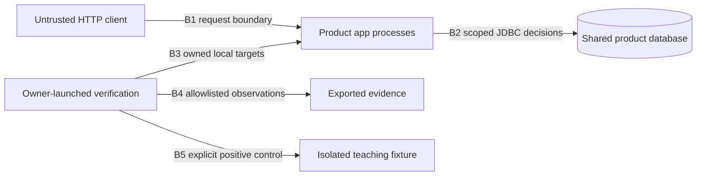

# Threat model

Slotkeeper v1 demonstrates room-booking controls on an owned local environment with synthetic people and workspaces. This model identifies the boundaries those controls address and the evidence needed to assess them. **Final integrated verification is pending.** A design statement or passing unit test is not proof that an end-to-end control passed; consult [DELIVERY.md](DELIVERY.md) and the actual rehearsal report.

## Assets, actors and assumptions

The protected assets are workspace/object confidentiality, reservation ownership, one active slot assignment, coherent transitions/expiry, nonrefundable booking allowances, retry identity, server sessions and bounded application resources. Evidence integrity also matters: a missing assertion must not become a passing security claim.

Potential attackers include an unauthenticated HTTP client, an authenticated member modifying requests, an admin seeking access outside their workspace, and concurrent clients racing valid or stale operations. Clients may supply arbitrary IDs, headers, bodies, retries and request timing. The browser's selected workspace, hidden navigation and countdown are untrusted inputs.

The local host, Docker daemon, database administrators, source/build tooling and the owner launching the scripts are trusted. All four account passwords are intentionally public local fixtures. The model does not claim secrecy from another local user who can log in with those credentials, read runtime files, alter code or administer Docker/PostgreSQL. No real tenant, identity or external-service data is accepted into the reference environment.

## Trust boundaries

| Boundary | What crosses it | Required treatment and limit |
| --- | --- | --- |
| B1: client → product | Credentials, cookie, CSRF token, IDs, JSON and request timing | Framework authentication/CSRF, strict typed input, server-owned actor, current scoped authority, safe errors and bounded admission. Local HTTP does not protect transport confidentiality. |
| B2: app → PostgreSQL | Actor/workspace predicates, locks, SQL values, sessions and counters | Bound SQL parameters, scoped queries/composite FKs, transaction locks and fresh DB time. One runtime role spans the synthetic workspaces; isolation depends on application decisions rather than database row-level security. |
| B3: runner → targets | Requests and independent final-state checks | Only fixed IPv4 loopback ports and expected instance IDs, with launcher ownership checks. Public instance markers prevent accidents; a malicious local process can imitate one. |
| B4: runtime → evidence | Revision, status/code/request IDs, assertions, outcome counts and policy metadata | Typed allowlisted observations only. Exclude passwords, cookies, CSRF/authorization material, raw request bodies and runtime-folder dumps. Hash inventories detect byte changes but are not signatures or attestations. |
| B5: runner → fixture | A fixed synthetic authorization exercise | Separate artifact/process, reduced fixture actor and no product sessions/database. The deliberately missing scope check must never enter the product dependency graph or normal runtime. |

## Threats and observable controls

The statuses below describe the specific validly formed scenario. Requests with multiple invalid properties may be rejected at an earlier admission or CSRF boundary.

| Threat | Control and required observation | Evidence case |
| --- | --- | --- |
| Anonymous booking access | Authenticated API boundary; `401`, no booking effect | A01 |
| Cross-workspace object lookup | Current membership and workspace/owner predicates; `404`, no foreign resource fields | A02 |
| Cancel another member's reservation | Owner checked within the requested scope; `404`, target state unchanged | A03 |
| Globalize an admin role or submit authority | Workspace-specific role; member admin action `403`; forbidden owner/role/workspace fields `400`; no escalation | A04 |
| Drive a browser mutation without CSRF | Framework token on login/logout/mutations; missing/invalid token `403`, no business effect | A05 |
| Duplicate effects through concurrent retries | Scoped unique receipt, typed fingerprint and same-transaction effect; same identity, one effect | A06 |
| Reuse a key with changed input | Fingerprint conflict `409`, original effect unchanged | A07 |
| Confirm after expiry or after a lock wait | Fresh database time after locks; exact deadline excluded; `409`, no late confirmation | A08 |
| Release a replacement via a stale action | Expected-ID assignment release and terminal states; replacement assignment survives | A09 |
| Hoard active slots | Actor/workspace guard and at most two live holds; extra distinct hold rejected without corrupting existing holds | A10 |
| Bypass admission with forwarding headers | Atomic shared fixed-minute counters and actual connection peer; 130 requests with at most eight in flight, observed `429` and `Retry-After` | A11 |
| Win the same last slot concurrently | Slot/actor row locks, conditional assignment and relational constraints; classified HTTP outcomes plus independent two-process PostgreSQL evidence | A12 |
| Mistake a dead exercise for protection | Separate fixture actually leaks its fixed foreign object; the hardened comparison denies access | T01 |
| Lose session/logout semantics across replicas | Shared JDBC sessions, rotated login session and cross-process logout invalidation | S01 |
| Hide a broken final database invariant or excessive runtime privilege | Read-only consistent snapshot checks assignments, quotas, receipts, events and runtime permissions | S02 |

Supplementary checks cover daily allowance after cancellation, current membership after login/replay, malformed/duplicate/unknown fields, oversized bodies, login admission, literal display of hostile-looking room text, dependency failures and workspace-date/DST boundaries. These remain explicit release requirements, not implied successes from the case table.

## Resource and data controls

The body cap is 16 KiB. Username/password lengths are bounded before password verification; Argon2id uses a 16-byte salt, 32-byte hash, 19,456 KiB memory, two iterations and parallelism one. A four-job semaphore bounds both encoding and verification per application process, including cold-provider dummy-hash initialization. Shared login admission is 20 attempts per actual peer per UTC fixed minute; anonymous CSRF creation is 60. Authenticated mutations use 60 per actor/workspace per UTC fixed minute. Fixed-window boundaries allow a burst spanning two windows. These controls do not universally limit reads, aggregate bandwidth, connection exhaustion or a distributed bot population.

Booking allowances and capacity remain separate from traffic admission. Workspace room creation is capped at 20, including disabled rooms, with the cap and initial slot provisioning serialized in one transaction. Current membership precedes actor/workspace bucket allocation to prevent arbitrary scope IDs from creating buckets. Retrying a successful operation still requires current authentication, scope and admission. A replay reports the current authorized resource state and does not grant a historical authorization. Lock/statement/connection waits are bounded, and database failures must fail closed with safe errors rather than disable the guard.

Room text is rendered as text. The packaged app sets a restrictive same-origin content-security policy and framing policy; these are defense layers, not a claim that every possible XSS technique was tested. Public errors use stable safe messages and request IDs without SQL, stack traces or submitted input. Logs and exported evidence must exclude credentials and session material.

Runtime database credentials cannot update/delete historical booking events. Activity is a scoped view of successful product events, not an immutable forensic audit trail. Database/host administrators can alter it; denied-request diagnostics do not belong in the public activity feed.

## Evidence interpretation

- `PASS`: every required observation supports the case under the recorded conditions.
- `FAIL`: an observed product/control result contradicts the case.
- `ERROR`: the harness, protocol or dependency could not produce a trustworthy observation.
- `INCOMPLETE`: a prerequisite or required independent evidence was unavailable.

Expected negative HTTP responses are product observations; a broken harness is not evidence of a working control. A report is complete only when the entire required inventory passes, including T01, S01 and S02. A12 cannot pass its database claim using rate-rejected HTTP requests. Test counts, contention results and latency observations have different scopes and must remain distinct.

## Explicit exclusions and residual risk

This v1 is not internet-facing service hardening, a security certification, a comprehensive penetration test or a production capacity benchmark. It uses local HTTP with `Secure=false`, public fixture identities and trusted local administration. Binding host ports to loopback reduces accidental exposure; it does not isolate hostile software on the same machine.

Registration/recovery, external OIDC/passkeys/MFA, TLS deployment, external secrets management, real tenant onboarding, backups/HA/disaster recovery, notifications/payments, broad bot detection and flexible/multi-resource bookings are outside the release. PQC/signing integration is not present in v1. Moving to real users or external exposure requires a new deployment and threat review, different identity/credential provisioning and evidence for that environment.
